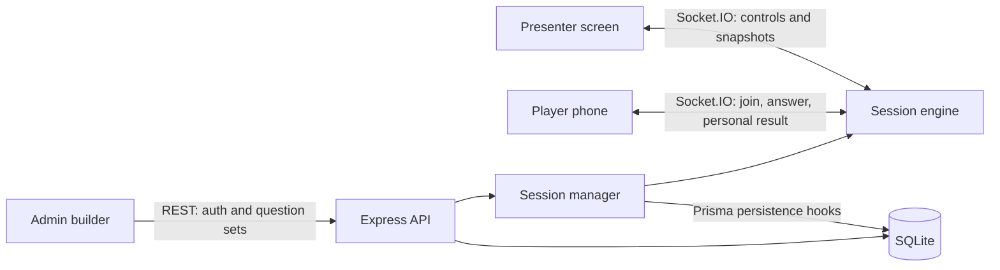

# LiveVote repository reference

Reviewed October 19, 2026. This describes the working tree, including the existing uncommitted results-summary work. It is a reference for future development, not a claim about what is currently deployed.

## Scope and verification

Reviewed application source, shared contracts and validation, Prisma schema and migrations, server and browser tests, build configuration, CI, Docker configuration, operational scripts, and existing documentation. Real environment-file values were not inspected or included. No application code, existing work, production services, or application databases were changed during this review.

| Check | Result |
| --- | --- |
| Node / npm available | Node 20.20.2 / npm 10.8.2 |
| Shared typecheck | Passed through root typecheck |
| Server typecheck | Failed: 10 diagnostics associated with unfinished summary integration |
| Client typecheck, run separately | Failed: editor input omits required `showResultsSummary` |
| All five migrations against an empty isolated SQLite database | Passed |
| Server Vitest suite against isolated database | **182 tests passed across 21 files**, including 50- and 100-player socket tests |
| Production build | Not run; the client build includes the failing typecheck |
| Browser E2E | Not run; current source cannot complete the normal build prerequisite |
| Docker build / deployment / live-site verification | Not performed |
| Dependency advisory audit | Not performed; historical security-document counts are not current verification |

Test database: `/tmp/livevote-repo-review-20261019.db`. Test credentials and database URL were supplied explicitly to avoid local environment configuration. Local socket tests required running outside the socket-restricted sandbox. Initial Prisma creation failed until the empty SQLite file was created; migrations then succeeded. Migration verification establishes a fresh install, not an upgrade of populated production data.

The starting working tree already modified nine tracked files across shared contracts, session logic, routes, and Prisma schema, with an untracked summary migration. Preserve those changes when implementing follow-up work.

## Product and architecture

Despite the directory name, the application is branded **LiveVote**, a classroom/event polling and quiz platform. It supports anonymous account-free player entry via six-digit PIN and nickname, with an authenticated admin and presenter.

It is an npm workspace monorepo:

| Area | Responsibility | Main entry points |
| --- | --- | --- |
| `shared/` | Domain types, Zod validation, socket contracts, grading, scoring, avatars, write-in normalization/grouping | `src/domain.ts`, `events.ts`, `schema.ts`, `questionTypes.ts`, `scoring.ts`, `writeIn.ts` |
| `server/` | Express REST API, Socket.IO, authoritative game engine, Prisma persistence | `src/index.ts`, `app.ts`, `session/engine.ts`, `session/manager.ts` |
| `client/` | React 18, React Router 6, Vite 5, Tailwind, animation and audio | `src/main.tsx`, `admin/`, `host/`, `play/` |
| `e2e/` | Playwright host/player browser scenarios | `helpers.ts` and feature-specific specs |
| Root operations | Local startup, Docker, Cloudflare deployment, password rotation, backup | `run.sh`, `livevote.sh`, `tunnel.sh`, `reset-admin-password.sh`, `scripts/backup-db.sh` |



Production runs as one Node process serving the built SPA, REST API, and sockets on port 3000. Development serves Vite on 5173 and proxies `/api` and `/socket.io` to 3000. Socket event names and payload types are shared at compile time; that does not itself validate incoming runtime payloads.

## User flows and client ownership

| URL | Flow and implementation |
| --- | --- |
| `/` | Landing page in `client/src/Landing.tsx` |
| `/admin` | Authentication gate and question-set list; `AdminApp.tsx`, `LoginGate.tsx`, `SetList.tsx` |
| `/admin/set/new`, `/admin/set/:id` | Builder, reorder, preview, validation, save/start; `SetEditor.tsx`, `editorModel.ts`, `QuestionCard.tsx`, `QuestionPreview.tsx` |
| `/host/:sessionId` | Lobby/PIN/QR, question, reveal/moderation, leaderboard, end screen; `HostApp.tsx`, `useHostSession.ts`, `Controls.tsx`, `screens/` |
| `/play?pin=...` | Join/avatar selection, input, submitted state, personal results, standings/end; `PlayApp.tsx`, `usePlaySession.ts`, `QuestionInput.tsx` |

`client/src/lib/api.ts` wraps same-origin credentialed fetch and structured API errors. `lib/socket.ts` creates sockets with credentials and websocket/polling transports. Hooks translate server events into local display state. `useCountdown.ts` estimates server clock offset for display; it does not determine answer acceptance. Player reconnect credentials live in localStorage under `livevote.player` and represent one saved player identity per origin.

The host receives reveal charts and optional voter identities; player clients receive their own answer result. Lobby lists and intermediate leaderboards are host-only. Final session events broadcast the full scoreboard, including nicknames, to all joined clients.

Visual identity is primarily `client/src/index.css`, `client/tailwind.config.js`, `components/Shape.tsx`, and `OptionTile.tsx`. Brand red is `#e4002b`. Shared avatar/color rules live in `shared/src/avatars.ts`; `NameTag.tsx` and `Emoji.tsx` render identity pills and bundled Twemoji SVGs. There are 30 avatar choices and 16 assigned colors. External fonts have system fallbacks.

## Game lifecycle and rules

The synchronous `SessionEngine` owns state, timers, players, answers, moderation, and scoring. A scheduler and emitter are injected so tests can control time and inspect recipient scope without real networking. The engine has persistence hooks but no direct database calls.

Normal transitions:

```text
LOBBY --START--> QUESTION --timer / all answered / SKIP--> REVEAL
REVEAL --NEXT, quiz--> LEADERBOARD --NEXT--> next question
REVEAL --NEXT, poll--> next question
last question --> SUMMARY when enabled and polls exist, otherwise ENDED
SUMMARY --NEXT--> ENDED
END --> ENDED
```

`SUMMARY` is unfinished in this working tree; see findings below. Disconnected players still count as active until kicked, allowing reconnect but preventing early completion if they have not answered. Fresh joins require LOBBY; valid reconnect tokens can restore an existing identity in later states. Players get one accepted answer per question. The server verifies question identity, state, kicked status, answer shape/type, and timing.

Scoring lives in `shared/src/scoring.ts`. Timed correct answers earn a speed-weighted base from 1000 down to 500; untimed answers receive a flat base of 1000. DOUBLE doubles the base. Consecutive correct answers add 100 per step after the first, capped at 500. NONE gives zero points while a correct answer still advances the streak. Wrong/missing quiz answers reset the streak; polls preserve it. Slider partial credit scales the base, while streak bonus remains unscaled. Equal total scores are ordered alphabetically and receive distinct sequential ranks.

There is a declared 750ms late-answer grace check, but the question timer reveals at the nominal deadline. Once revealed, state validation rejects answers, so this is not a guaranteed extra 750ms response period.

## Question types

| Type | Modes | Validation/grading/reveal |
| --- | --- | --- |
| Multiple choice | Poll, Quiz | 2–4 options, one selected; quiz requires one correct choice |
| Multiple select | Poll, Quiz | 2–6 options; exact correct set for quiz credit |
| True/False | Poll, Quiz | Exactly two options, configurable labels |
| Type answer | Quiz | Accepted answer list, optionally exact; otherwise case/space/accent normalization; max 40 characters |
| Open ended | Poll | Max 120 characters; profanity filtering; whole normalized responses grouped into a cloud or shown as cards |
| Slider | Poll, Quiz | Numeric bounds; quiz correct value and tolerance with partial credit; reveal distribution/average/median |
| Ordering | Quiz | 3–5 items; exact original option order required |
| Rating | Poll | Integer 1–5 or 1–10; distribution/average |
| Write-in | Poll | Text normalization, optional suggestions/restricted roster, grouped bars, hide/merge/undo and review UI |

`shared/src/schema.ts` validates set CRUD/import, including mode/type compatibility, options, correctness indices and per-type config. `server/src/session/answers.ts` canonicalizes submitted answers and computes reveal data. `shared/src/questionTypes.ts` grades answers and strips secret config for players. `shared/src/writeIn.ts` implements grouping, spelling selection, merge resolution and duplicate suggestions. Poll winners are computed after relevant moderation in `answers.ts` and highlighted in `Reveal.tsx`; tied top groups are supported.

Write-in matching ignores case, accents, repeated spaces, and trailing `.?!`. Near-match suggestions require explicit host merging; they do not automatically combine votes. Hidden answers and merge state remain in engine memory and are reflected in runtime CSV export. They are not represented as persisted moderation records in the Prisma schema.

## Persistence and API

Database graph:

```text
QuestionSet -> Question -> Option
QuestionSet -> Session -> Player -> Answer
Answer -> Question and optional Option
```

SQLite enum-like fields are strings; type-specific question config and canonical answers use JSON strings. Prisma enforces unique player nickname per session and one answer per player/question. Session deletion cascades to players and answers. Question deletion cascades to historical answers. A set with session references is protected by the Session-to-set restrict relation.

The manager snapshots a set when starting a session, creates persisted players before adding them to the engine, maps PINs to engines, and routes events to session/host/player rooms. Answers, scores, connectivity and transitions are written asynchronously; errors are swallowed. SQLite is not used to reconstruct sessions after a process restart.

| API surface | Access and behavior |
| --- | --- |
| `GET /api/health` | Public process health; does not check database readiness |
| `POST /api/auth/login`, `POST /logout`, `GET /me` under `/api/auth` | Password login, cookie clearing, auth status |
| `GET /api/public/config` | Public join base URL |
| `GET /api/public/session/:pin` | Existence, lobby joinability, title and state |
| `/api/sets` GET/POST, `/:id` GET/PUT/DELETE | Admin set CRUD |
| `GET /api/sets/:id/export`, `POST /api/sets/import` | Version-1 JSON envelope; import also accepts raw set input |
| `POST /api/sets/:id/start` | Admin starts a runtime session with PIN |
| `GET /api/sessions/:id` | Admin reads runtime existence/basic metadata |
| `GET /api/sessions/:id/results.csv` | Admin exports from runtime engine, not persisted answer history |
| `DELETE /api/sessions/:id/data` | Admin removes runtime reference and persisted session data |

Set updates replace all questions/options inside a transaction. IDs change; this is not a patch update. JSON exports intentionally use correct option indices rather than database IDs. CSV contains identity, answers, timings, points and write-in moderation information, with formula-prefix neutralization.

## Authentication and operational configuration

One shared admin credential protects all sets and sessions; there are no per-user accounts or owner permissions. Prefer `ADMIN_PASSWORD_HASH` in `scrypt:<salt>:<hash>` format; plaintext `ADMIN_PASSWORD` is supported. Legacy dollar delimiters are accepted by the verifier, but colon delimiters avoid Compose interpolation problems. A signed `lv_admin` cookie is HttpOnly, SameSite=Lax, Secure in production, with server-checked 12-hour lifetime. Rotating SESSION_SECRET invalidates cookie verification. Password changes alone do not invalidate existing tokens.

Configuration is loaded by `dotenv/config` from the process working directory. npm workspace server scripts run from `server/` and use `server/.env`; Docker Compose reads the root `.env` and explicitly forwards selected variables. Running `node server/dist/index.js` from the root differs from `npm start` in this respect. Do not assume the IDE's root `.env` configures every invocation.

| Variables | Meaning |
| --- | --- |
| `DATABASE_URL` | SQLite path; relative Prisma file paths resolve relative to schema location |
| `PORT`, `NODE_ENV` | Listener; production auth cookie and security behavior |
| `PUBLIC_BASE_URL` | QR/join URL supplied to host |
| `CORS_ORIGINS` | Allowed REST response origins and Socket.IO CORS settings |
| `ADMIN_PASSWORD_HASH`, `ADMIN_PASSWORD`, `SESSION_SECRET` | Admin authentication and token signing |
| `TRUST_PROXY` | Enables Cloudflare client-IP header trust; appropriate only behind the trusted ingress |
| `DATA_RETENTION_DAYS` | Defaults to 30; DB purge on startup and daily |
| `MAX_PLAYERS_PER_SESSION`, `MAX_ACTIVE_SESSIONS` | Defaults 300 and 100 in direct server configuration |
| `TUNNEL_TOKEN` | Passed to cloudflared by production Compose |

Production Compose currently does not forward the two MAX_* overrides; putting them in root `.env` alone does not change container defaults.

Deployment paths:

- `run.sh`: local setup/dev or build/start convenience. Its `prod` branch does not itself export NODE_ENV=production. It only migrates when the default dev database is absent, so it does not apply every new migration to an existing database.
- `docker-compose.yml`: publishes port 3000 and persists SQLite in a named volume. With NODE_ENV=production, admin access is intended to use HTTPS; the README's plain-HTTP Docker quickstart needs reconciliation with Secure cookies.
- `docker-compose.prod.yml`: app has no host port; cloudflared reaches it on a private Docker network. TRUST_PROXY is true. Tunnel release is pinned. No live tunnel state was checked.
- `Dockerfile`: Node 20 slim, multi-stage build, non-root runtime, OpenSSL for Prisma, healthcheck. Uses npm install and copies all dependencies, including development dependencies.
- `docker/entrypoint.sh`: migrates, attempts seed on every startup, then starts Node. Seed failure is explicitly tolerated.
- `livevote.sh`: start/stop/status/log/restart/rebuild operations for production Compose. `update` rebuilds current local code; it does not fetch Git updates. `restart` does not recreate container environment after `.env` changes.
- `tunnel.sh`: mutates local env, Cloudflare tunnel configuration and DNS, and starts deployment; requires explicit operational intent before execution.
- `reset-admin-password.sh`: updates the root env hash and recreates a running app when detected. It does not rotate SESSION_SECRET.
- `scripts/backup-db.sh`: VACUUM INTO snapshot, copy/gzip, retention cleanup; fallback copies a running database file and offers weaker consistency guarantees.

## Findings and implications for future changes

These are source observations unless a test result is explicitly cited. They should be addressed according to the feature being changed; no fixes were made in this review.

1. **Current summary integration blocks typechecking and building.** Missing `buildHostSummary()` and `buildPlayerSummary()` methods, incomplete host/player snapshots, fixtures missing `showResultsSummary`, and missing editor conversion cause compiler errors. The declared `host:setShowSummary` event has no server handler. Host/player hooks and screens do not consume summary events or render SUMMARY, and host Next/keyboard mappings omit it. Reaching the summary path can throw after the engine changes state. Existing tests pass because their relevant engine fixtures omit the new flag, and they do not exercise this path. Complete the entire contract-to-UI flow and tests together.

2. **Ordering leaks the answer through option metadata.** `shuffledOptions()` shuffles the array but preserves each option's original `index`; grading uses exactly that index to define correct order. A player can reconstruct the solution by sorting the public payload. Replace original indices with safe display positions for this type and add a payload-level regression test. Current no-leak tests do not cover this inference.

3. **Socket runtime validation is incomplete.** Several handlers destructure incoming objects and call acknowledgements without checking their shapes. `player:answer` guards the acknowledgement and catches errors inside its body, but parameter destructuring happens first. Malformed socket packets can throw before those guards. Use runtime schemas at every event boundary and validate callbacks. Existing security tests validate selected malformed answer values, not the entire event envelope.

4. **Host authorization is cached for the socket lifetime.** `socket.data.isAdmin` is assigned at connection and reused by subsequent host actions. Cookie expiry, logout, or secret rotation does not automatically revoke an already-connected authenticated host socket. Revalidate authorization for privileged events or implement server-side revocation/disconnect behavior if immediate revocation is required.

5. **Persistence is best-effort and live sessions are not recoverable after restart.** Async writes are neither awaited by answer acknowledgement nor logged on failure. Answer upserts and reveal scoring transactions are independently scheduled, so ordering/durability needs explicit testing. Shutdown closes the listener without awaiting a drained server or pending persistence, then exits. Do not promise crash recovery or durable acceptance without redesigning these paths.

6. **CSV availability and memory cleanup depend on how a session ends.** A host `END` action schedules disposal after 60 seconds. Natural completion through NEXT does not schedule that disposal, and abandoned lobbies have no expiry. The session cap counts all retained entries, including ended ones. After disposal or server restart, CSV returns 404 even though database rows may remain. Define runtime TTL and durable export requirements together.

7. **Set edits can erase historical answers.** PUT deletes old questions, whose Answer relations cascade; a running engine still holds the old question IDs. Editing a set during a live session can leave engine behavior functioning while persistence fails against removed records. Deleting a set that has sessions is restricted, but the route does not translate that DB error into a useful response. Consider immutable session question snapshots/versioned sets or explicit edit guards.

8. **Express 4 async route failures lack consistent forwarding.** Database operations in async handlers generally have no try/catch or async wrapper. Express 4 does not automatically forward rejected promises to the final error middleware. Constraint errors and database failures can therefore hang requests or surface as unhandled rejections. The generic handler also responds 500 to errors without distinguishing malformed JSON or oversized input.

9. **Joining and socket identity have concurrency/lifecycle gaps.** Player cap, case-insensitive nickname availability and unused-avatar checks occur before awaiting database creation; simultaneous joins can race those checks. The DB nickname uniqueness is not equivalent to the engine's case-insensitive comparison. A socket can join additional identities/rooms without leaving old ones. Multiple sockets sharing one reconnect identity can mark the player disconnected when just one closes. Kicked sockets retain room membership, although subsequent answer submission is rejected.

10. **External question images conflict with the production CSP.** Validation accepts arbitrary URL images and the UI renders them, but `img-src` allows only self and data. External images that load through Vite may fail when served by Express. Pick an explicit image hosting/proxy/allowlist policy before changing this feature.

11. **Seed data bypasses shared validation and startup seeding can fail.** Mixed-type examples use 15/25-second limits while shared schemas only allow 10/20/30/60/null, so those sets can fail builder save or import round-trip. Seed startup deletes and recreates sets by title; an existing session reference can block deletion, and entrypoint tolerates the failure. User edits to matching seed titles can also be replaced when deletion succeeds. Separate sample-data provisioning from routine production boot.

12. **Retention does not cover runtime memory or backups.** Daily DB purge uses session creation time and does not remove matching in-memory engines. Manual disposal also does not cancel the engine timer or notify sockets. Backups have independent retention. Coordinate memory, DB, sockets and backup policy if expanding privacy guarantees.

13. **Additional validation/display edges deserve targeted tests when touched.** TRUE_FALSE permits multiple correct indices; slider step is not enforced on submitted values; type-answer exact grading is combined with normalized reveal buckets and can produce confusing reveal labels; poll correctness is not uniformly null for choice-based types even though points remain zero. The declared config shape is broad and not a per-type discriminated union.

14. **Documentation records older snapshots.** FINDINGS.md and SECURITY-FINDINGS.md contain historical green-suite/advisory claims. README layout/scoring explanations are useful but some counts, setup examples, and event comments have drifted. For example, socket contract comments describe reveal broadcasting to everyone while implementation sends charts to host only. Runtime source and freshly run checks take precedence.

## Test strategy and change map

Vitest executes files serially with a shared configured SQLite database. Pure engine tests use FakeScheduler and CapturingEmitter. Integration tests create real HTTP/socket servers; load tests exercise successful concurrent players, not broad resource-exhaustion or adversarial behavior. Playwright uses one Chromium worker and browser contexts for host/players. Its local server uses an isolated e2e database, but `scripts/e2e-server.sh` only migrates/seeds and launches an existing build; **it does not build** despite README wording. CI builds first, so this dependency is satisfied there. PLAYWRIGHT_BASE_URL targets an external deployment and those tests can create/delete live data; do not run casually against production.

The `lint` scripts are TypeScript checks, not a separate lint ruleset. No frontend unit-test runner is configured. Passing Vitest does not guarantee TypeScript success because test execution transpiles code without enforcing all static checks.

| Requested change | Likely files and verification |
| --- | --- |
| Brand, layout, responsiveness | `client/src/index.css`, Tailwind config, relevant screens/components; build and affected browser flows |
| Question builder behavior | `admin/QuestionCard.tsx`, `editorModel.ts`, `SetEditor.tsx`, preview, shared schema; schema/import/export and E2E tests |
| New question type | Shared type/config/answer/grading/schema; Prisma migration if storage changes; answer preparation/results/CSV; builder, preview, player input, host reveal; all boundary and privacy tests |
| Scoring or winners | `shared/src/scoring.ts`, `questionTypes.ts`, `server/src/session/answers.ts`, engine; scoring, answers, winners and game-flow tests |
| Session progression/summary | Engine, domain/events, socket handlers, manager serialization, both client hooks/screens/controls, fixtures, lifecycle E2E |
| Voter names/privacy | Engine emitter scope, `answers.ts`, snapshots, host reveal, player notice, summary and CSV; no-leak/voter-names tests |
| Reconnect/join/avatars | Socket handlers, manager, engine identity functions, `usePlaySession.ts`, avatar constants; socket, reconnect and avatar tests |
| Data model/history/export | Prisma schema + migration, manager hooks, routes/serialize, CSV; fresh and populated DB migration tests plus persistence checks |
| Auth/security | `auth.ts`, env, auth routes, socket authorization, app middleware, client API/login; security and malformed-payload tests |
| Deploy/configuration | Env examples, Compose, Dockerfile, startup scripts, DEPLOY.md; validate actual invocation path and test in an isolated stack |

For future work, first inspect the current Git diff and this reference, then reopen the relevant implementation and tests because the repository may have evolved. Resolve the summary integration before treating this working tree as deployable. A sensible follow-up sequence is build restoration, public-payload/socket validation, persistence/history reliability, then operational cleanup according to event needs.
